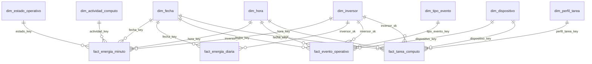

# Modelo dimensional (§4 C)

## 1. Arquitectura de capas

| Capa | Dónde | Qué contiene | Regla |
|---|---|---|---|
| **Bronze** | `datos/zenodo/opencem-v1.0.0.sqlite` + esquema `bronze` en PostgreSQL | El archivo original y su copia 1:1 de las columnas usadas (con `context.value` como `jsonb`) | Nunca se modifica; sin limpieza |
| **Silver** | Esquema `silver` | Datos limpios, en hora local, agregados a **1 minuto**, JSON ya parseado, eventos detectados | Reglas de limpieza con conteos (Fase 5) |
| **Gold** | Esquema `gold` | Modelo en estrella: dimensiones y hechos que consumen Power BI y Grafana | Llaves sustitutas, miembros "desconocido" |

## 2. Elección: esquema en estrella (*star schema*)

Elegimos **estrella** y no copo de nieve porque:

1. **Power BI** está optimizado para estrellas: relaciones 1:* directas, filtros de un solo salto y DAX más simple.
2. **Las dimensiones son pequeñas** (la más grande, fecha, tiene unas 400 filas): normalizarlas no ahorra espacio relevante y sí agrega *joins*.
3. **Grafana** consulta con SQL escrito a mano: menos *joins* significa consultas más rápidas y legibles.
4. Las jerarquías (año › mes › día, categoría › tipo de evento) caben como columnas de la misma dimensión.

Se aceptan pocas excepciones conscientes: `dim_tarifa` es una tabla de parámetros con vigencia, no una
dimensión enlazada por llave (ver §6).

## 3. Procesos de negocio y grano de cada hecho

| # | Proceso de negocio | Tabla de hechos | Tipo | **Grano (una fila =)** | Filas estimadas |
|---|---|---|---|---|---|
| 1 | Medición de flujos de energía | `fact_energia_minuto` | Periódica (*periodic snapshot*) | **un inversor en un minuto local** con al menos una lectura | ≈ 800 000 |
| 2 | Cierre diario y conciliación | `fact_energia_diaria` | Periódica | **un inversor en un día local** con al menos una lectura | ≈ 640 |
| 3 | Eventos operativos | `fact_evento_operativo` | Transaccional | **un evento** (red caída, falla, batería baja, hueco de datos, apagado…) con inicio y fin | ≈ 25 000 |
| 4 | Ejecución de tareas de cómputo (SolarBI) | `fact_tarea_computo` | Transaccional | **una tarea registrada** en las bitácoras JSON (compilación CPU o entrenamiento GPU) | ≈ 14 900 |

## 4. Diagrama

## 5. Dimensiones

| Dimensión | Grano | Atributos principales | Jerarquía | Origen |
|---|---|---|---|---|
| `dim_fecha` | Un día local | año, trimestre, mes, nombre del mes, semana ISO, día de la semana, fin de semana, **tipo de día** (laboral / fin de semana / festivo), **periodo académico** (clases, exámenes, vacaciones) | Año › Trimestre › Mes › Día · Año › Semana › Día | Generada + `context` (`calendar_day` y entradas manuales del calendario académico) |
| `dim_hora` | Un minuto del día (0–1439) | hora, minuto, `HH:MM`, franja del día (madrugada, mañana, tarde, noche), **franja tarifaria EPM** (punta 9–12 h y 18–21 h / fuera de punta) | Franja › Hora › Minuto | Generada |
| `dim_inversor` | Una versión de un inversor (**SCD tipo 2**) | id (1 o 2), nombre, cargas que alimenta, versión de firmware, prioridad de salida, prioridad de carga, potencia máxima de red, capacidad de batería (Ah y kWh), SoC de alarma y de corte, `vigente_desde`, `vigente_hasta`, `es_vigente` | Inversor › Versión | `specs`, `settings` |
| `dim_estado_operativo` | Una combinación de estados (*junk dimension*) | modo de salida (apagado / red / inversor), estado de carga (no carga / cargando / otro), **régimen de red** (conectado / isla / sin dato) | Régimen › Modo de salida | `status` + `analog_measurements.linevolta` |
| **`dim_actividad_computo`** | Una combinación de tareas activas en un minuto | GPU activa, CPU estación 1 activa, CPU estación 2 activa, número de tareas, descripción, categoría (ocioso, cómputo ligero, cómputo intensivo, **sin bitácora**) | Categoría › Descripción | **Construida por nosotros** cruzando los intervalos de `context` con cada minuto |
| `dim_tipo_evento` | Un tipo de evento | código, nombre, categoría (red, batería, inversor, estación de trabajo, sitio, calidad de datos), severidad, origen, `es_calidad_dato` | Categoría › Tipo | Catálogo propio + códigos de `fault_history` |
| `dim_perfil_tarea` | Una combinación de características de tarea | categoría (compilación CPU / entrenamiento GPU), modelo de red, conjunto de datos, optimizador, librería compilada, esfuerzo estimado | Categoría › Modelo o librería | `context.value` (JSON) |
| `dim_dispositivo` | Un equipo que genera bitácoras | código, nombre, tipo (estación de trabajo, inversor, instalación), inversor que lo alimenta, CPU/GPU | Tipo › Dispositivo | `context.value ->> 'device'` + entradas manuales de hardware |

Todas las dimensiones tienen un **miembro desconocido** (llave 0, "Sin dato"): los hechos nunca llevan
llaves foráneas nulas, así los conteos de Power BI no pierden filas.

### 5.1 La dimensión que no existe en la fuente: `dim_actividad_computo`

La fuente solo tiene intervalos sueltos de tareas en JSON. Nosotros construimos, **para cada minuto**,
qué combinación de tareas estaba activa, y la convertimos en una dimensión de 9 miembros:

| Llave | Descripción | Categoría |
|---|---|---|
| 0 | Sin bitácora (fuera del 2025-10-29 → 2026-01-11 o inversor 2) | Sin bitácora |
| 1 | Sin tarea registrada | Ocioso |
| 2–4 | Solo CPU (estación 1, estación 2 o ambas) | Cómputo ligero |
| 5–8 | GPU sola o GPU + CPU | Cómputo intensivo |

Distinguir *"sin tarea"* de *"sin bitácora"* es clave: fuera de la ventana de las bitácoras no sabemos si
hubo cómputo, y tratarlo como "ocioso" sesgaría la línea base de SolarBI. Esta dimensión responde
P8–P10: con ella se compara, por ejemplo, la carga media de los minutos con GPU frente a los minutos ociosos.

### 5.2 Bonificación: dimensión de cambio lento (SCD)

**`dim_inversor` es SCD tipo 2.** La evidencia en la fuente:

| Fecha | Inversor | Cambio |
|---|---|---|
| 2025-08-29 | 1 | Firmware: compilación del `Mar 7 2025` → `Jul 1 2025`; prioridad de salida 2 → 0; potencia máxima de red 5 600 → 6 200 W; capacidad de batería 0 → 200 Ah |
| 2026-01-06 | 1 y 2 | Prioridad de carga 2 → 3 |

**Por qué tipo 2 y no tipo 1:** se quiere comparar el desempeño *antes y después* de cada cambio (¿mejoró
la autosuficiencia tras cambiar la prioridad de carga?). Con el tipo 1 se sobrescribe la configuración y los
hechos del pasado quedarían asociados a una configuración que no tenían. El tipo 2 crea una nueva fila con
`vigente_desde` y `vigente_hasta`, y cada hecho apunta a la versión vigente en su fecha.

**Regla contra el ruido:** `settings` parpadea entre lecturas (p. ej. `battpackrateah` alterna 0/200 más de
100 000 veces por lecturas incompletas). Una versión nueva se crea solo si la **moda diaria** del atributo
cambia y **se mantiene al menos 3 días seguidos**. El nombre del inversor se maneja como tipo 1.

`dim_tarifa` también cambia en el tiempo, pero se modela como tabla de parámetros con vigencia (§6).

## 6. Tabla de parámetros: `dim_tarifa`

| Atributo | Ejemplo |
|---|---|
| tipo de tarifa | Oficial / Industrial y comercial |
| franja | Monomia / Punta / Fuera de punta |
| valor (COP/kWh) | 864,06 |
| vigente desde / hasta | 2026-04-01 / 9999-12-31 |
| es base | sí / no |

No se enlaza por llave a los hechos: el costo se calcula en vistas SQL y en DAX tomando la tarifa vigente.
Así el **parámetro what-if** de Power BI puede cambiar la tarifa sin recargar los hechos.

## 7. Eventos operativos frente a lecturas

| | Lecturas (`fact_energia_minuto`) | Eventos (`fact_evento_operativo`) |
|---|---|---|
| Naturaleza | Muestreo periódico y continuo | Ocurrencias irregulares y escasas |
| Medidas | Energía (aditiva), SoC y temperatura (semiaditivas) | Duración, conteo, valor de referencia |
| Pregunta típica | ¿Cuánta energía solar hubo en marzo? | ¿Cuántas veces y cuánto tiempo estuvo caída la red? |

**Decisión:** los eventos van en **su propio hecho transaccional**, con inicio, fin y duración, y no como
columnas en las lecturas. Razones:

1. **Grano distinto:** un corte de red de 62 días es *un* evento, no 89 000 filas de minutos marcadas.
2. Como columnas serían casi siempre nulas (tabla dispersa) y contar eventos exigiría detectar
   cambios de estado en cada consulta.
3. Los eventos vienen de fuentes distintas (telemetría derivada, `fault_history`, `context`) y se unifican
   con `dim_tipo_evento`.

El **estado instantáneo** (¿hay red en este minuto?) sí vive en las lecturas, a través de
`dim_estado_operativo`, porque es un atributo de cada minuto y lo necesitan los paneles de Grafana.
Ambos hechos se cruzan por las dimensiones conformadas (fecha, hora, inversor).

**Eventos que se registran:**

| Código | Categoría | Cómo se detecta | ¿Real o de calidad? |
|---|---|---|---|
| `RED_CAIDA` | Red | `linevolta` = 0 durante ≥ 5 min | Real |
| `SOC_BAJO` | Batería | SoC < 20 % durante ≥ 5 min | Real |
| `TEMP_ALTA` | Inversor | `temper1` > 45 °C | Real |
| `FALLA_<código>` | Inversor | Registros únicos (código + hora) de `fault_history` | Real |
| `ALARMA_SISTEMA` | Inversor | `sysalarmflag` distinto de cero | Real |
| `APAGADO_INESPERADO`, `REINICIO`, … | Estación de trabajo | `context`: eventos de Windows | Real |
| `APAGADO_TIFON`, `AIRE_ON` / `AIRE_OFF` | Sitio | `context`: entradas manuales | Real |
| `HUECO_DATOS` | Calidad de datos | Sin lecturas durante > 10 min | **De calidad** (`es_calidad_dato` = sí) |

## 8. Matriz de bus (*bus matrix*)

| Proceso de negocio ↓ / Dimensión → | Fecha | Hora | Inversor | Estado operativo | Actividad cómputo | Tipo evento | Perfil tarea | Dispositivo | Tarifa* |
|---|---|---|---|---|---|---|---|---|---|
| 1. Flujos de energía (minuto) | ✔ | ✔ | ✔ | ✔ | ✔ | | | | ✔ |
| 2. Cierre diario y conciliación | ✔ | | ✔ | | | | | | ✔ |
| 3. Eventos operativos | ✔ | ✔ | ✔ | | | ✔ | | ✔ | |
| 4. Tareas de cómputo (SolarBI) | ✔ | ✔ | ✔ | | | | ✔ | ✔ | ✔ |

\* Por vigencia (fecha), no por llave.

Las dimensiones **conformadas** (fecha, hora, inversor, dispositivo) son las mismas tablas para todos los
hechos: así se puede poner en un mismo tablero la energía, los eventos y las tareas, y filtrar los tres
con el mismo segmentador.

## 9. Decisiones de diseño adicionales

- **Hora local:** `fecha_key` y `hora_key` salen de la hora local del sitio (Asia/Shanghai); el instante
  exacto se guarda además en UTC (`timestamptz`) para Grafana.
- **Origen de la fila:** `fact_energia_minuto.origen` distingue `historico` de `simulado`. El simulador
  inserta filas con `origen = 'simulado'`; Power BI filtra solo el histórico.
- **Asignación de energía a tareas que se solapan:** la energía incremental de un minuto se reparte en
  partes iguales entre las tareas activas en ese minuto.
- **Privacidad (Ley 1581):** de las bitácoras **no** se cargan comandos, directorios ni mensajes de Windows;
  solo el tipo de tarea y sus parámetros técnicos (detalle en la Fase 10).
