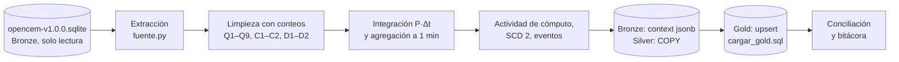

# ETL y calidad de datos (§4 E)

Código: [`etl/`](../etl/). Evidencia en la base: `silver.etl_ejecucion`, `silver.calidad_log` y
`silver.conciliacion`. Todas las cifras de este documento salen de la ejecución #3 sobre la base
recién creada (huella SHA-256 de la fuente `5fe1f213…d9fbb`).

## 1. Herramienta elegida: Python (pandas + psycopg)

| Criterio | Justificación |
|---|---|
| Lee la fuente sin herramientas extra | SQLite y JSON vienen en la biblioteca estándar de Python |
| Cálculo lectura a lectura | La energía es Σ P·Δt sobre 3 millones de lecturas: pandas lo hace vectorizado en segundos |
| Carga rápida | `COPY` de psycopg carga 782 217 minutos en unos 10 s |
| Gold dentro de la base | Silver → Gold es SQL (`etl/cargar_gold.sql`): se lee y revisa en DBeaver |
| Corre en un contenedor | Solo necesita `python` + 3 paquetes con versión fija (`etl/requirements.txt`) |
| Sin licencias | Todo es software libre |

Se descartaron herramientas gráficas (Pentaho, SSIS, Power Query) porque no corren como `Job` de
Kubernetes sin una instalación pesada, y dbt porque no lee SQLite ni integra potencia en el tiempo.

## 2. Flujo

Todo Bronze, Silver y Gold se carga **en una sola transacción**: si un paso falla, la base queda como
estaba y la ejecución queda registrada como `fallida` con el error (código de salida 1 para el `Job`).

## 3. Reglas de limpieza y su efecto

| Regla | Qué detecta | Tabla | Antes | Afectadas | Después | Acción |
|---|---|---|---|---|---|---|
| Q1 | Filas sin ninguna medición (falla de comunicación Modbus) | `analog_measurements` | 2 989 759 | 55 614 | 2 934 145 | descartar (cuentan como no disponibles) |
| Q4 | Batería a 0 V (imposible con el inversor encendido) | `analog_measurements` | 2 934 145 | 3 | 2 934 142 | descartar |
| Q2 | Nulos sueltos en alguna variable | `analog_measurements` | 2 934 142 | 19 855 | 2 934 142 | marcar: la variable nula no entra al cálculo |
| Q5 | Temperatura interna < 0 °C | `analog_measurements` | 2 934 142 | 100 | 2 934 142 | anular `temper1` |
| Q6 | Carga > 3 000 W | `analog_measurements` | 2 934 142 | 23 | 2 934 142 | marcar (atípica pero posible: se conserva) |
| Q7 | Potencia de red negativa | `analog_measurements` | 2 934 142 | 9 | 2 934 142 | recortar a 0 |
| Q3 | Huecos > 60 s entre lecturas | `analog_measurements` | 2 934 142 | 94 827 | 2 934 142 | recortar Δt a 60 s (no se extrapola) |
| Q9 | Lecturas de estado sin modo de salida | `status` | 2 240 052 | 58 196 | 2 240 052 | marcar: el minuto queda "Sin dato" |
| A1 | Agregación a 1 minuto por inversor | `analog_measurements` | 2 989 759 | — | 782 217 | agregar |
| C1 | Claves con datos personales en el JSON (en cualquier nivel) | `context` | 25 178 | 18 454 | 25 178 | anular las claves |
| C2 | Intervalos con fin antes del inicio | `context` | 25 178 | 0 | 25 178 | recortar |
| D2 | Contadores diarios que contradicen las lecturas del mismo día | `statistics` | 542 días | 37 | 542 | anular el contador |
| D1 | Días con lecturas pero sin contador válido | `statistics` | 642 días | 181 | 642 | la energía oficial es la integrada |
| Q11 | Capacidad de batería en 0 Ah | `settings` | 497 días | 237 | 497 | imputar 200 Ah (supuesto) |
| S1 | Lecturas de configuración → versiones del inversor | `settings` | 2 284 775 | — | 5 versiones | agregar (moda diaria estable ≥ 3 días) |
| F1 | Historial de fallas repetido en cada lectura (32 ranuras) | `fault_history` | 2 129 517 | — | 20 516 | deduplicar |
| E1 | Eventos con la misma clave (inversor, tipo, inicio) | `silver.evento` | 29 108 | 1 | 29 107 | deduplicar |
| E2 | Fallas anteriores al calendario (antes del 2025-07-01) | `silver.evento` | 29 107 | 11 | 29 096 | descartar |

Los umbrales (60 s, 3 000 W, 20 %, 45 °C, 5 y 10 min, 200 Ah) son variables de entorno, no constantes en el
código (ver [`etl/README.md`](../etl/README.md)).

## 4. Dato inválido frente a evento operativo real

Criterio (detallado en [02_diagnostico_fuente.md](02_diagnostico_fuente.md) §4): **un dato es inválido si
es físicamente imposible o lo contradice otra fuente; un evento es real si es físicamente posible y
consistente con las demás fuentes.**

| Caso | Decisión | Tratamiento |
|---|---|---|
| Batería a 0 V | Inválido | Se descarta la lectura (Q4) |
| Red con tensión 0 durante horas | **Evento real** (`RED_CAIDA`) | 17 episodios, 1 836 h; confirmados por `context` |
| SoC < 20 % durante ≥ 5 min | **Evento real** (`SOC_BAJO`) | 28 episodios |
| Fila sin mediciones | Falta de registro | No se convierte en ceros: baja la disponibilidad (K4) |
| Contador diario del inversor 1 en ~25 kWh/día del 26-sep al 21-oct-2025 | **Inválido** (D2) | Sus propias lecturas dan ~3 kWh/día y el valor es casi igual al del inversor 2: tras el apagado por el tifón (22 al 25-sep) el registrador leyó los contadores del equipo equivocado |
| Inversor 2 con carga 0 desde el 6-abr-2026 y FV 0 desde el 10-abr | **Evento real** | Lecturas válidas y continuas: la climatización se apagó y el arreglo FV se desconectó |

## 5. Frecuencia de agregación de Silver: 1 minuto

| | |
|---|---|
| **Se gana** | Grano uniforme para los dos inversores (cadencia irregular de ~12,6 s) · 782 mil filas en lugar de 3 millones: Power BI importa rápido y Grafana consulta rápido · es la resolución de las alertas (5 min de red caída, 2 min sin datos) · coincide con el grano de la actividad de cómputo (tareas de 1 a 15 min) |
| **Se pierde** | Picos de menos de un minuto (se conserva el **máximo** de carga del minuto, `p_carga_max_w`, para no perderlos del todo) · el orden exacto de eventos dentro del minuto · la variabilidad entre lecturas (la energía no se pierde: se integra lectura a lectura **antes** de agregar) |
| **Descartado: 15 min o 1 h** | Borraría los eventos cortos (temperatura alta dura 6 min en promedio) y no permitiría asignar energía a tareas de 1–2 min |
| **Descartado: sin agregar** | 3 millones de filas con marcas irregulares; Grafana y Power BI tendrían que agregar en cada consulta |

## 6. Conciliación (reconciliation)

| Métrica | Inv. | Fuente | Cargado | Dif. | Explicación |
|---|---|---|---|---|---|
| Lecturas | 1 | 1 610 276 | 1 610 276 | 0 % | Cada lectura queda contada en `n_lecturas` (también las inválidas) |
| Lecturas | 2 | 1 379 483 | 1 379 483 | 0 % | |
| Minutos con lectura | 1 / 2 | 410 768 / 371 449 | igual | 0 % | Un minuto de Gold por cada minuto con lectura |
| Registros de `context` | — | 25 178 | 25 178 | 0 % | Copia 1:1 en `bronze.context` |
| Tareas de cómputo | 1 | 14 929 | 14 929 | 0 % | Una fila por tarea |
| Fallas únicas | 1 / 2 | 12 813 / 7 692 | igual | 0 % | Desde el inicio del calendario |
| **Carga, días completos** (≥ 95 % de cobertura) | 1 | 1 232,8 kWh | 1 230,0 kWh | **−0,2 %** | La integración valida el contador |
| **Carga, días completos** | 2 | 1 311,3 kWh | 1 310,0 kWh | **−0,1 %** | |
| FV, días completos | 1 / 2 | 712,6 / 453,1 | 647,0 / 441,1 | −9,2 % / −2,6 % | El contador FV del inversor incluye pérdidas internas que no ve `pv1power` |
| Red, días completos | 1 / 2 | 640,4 / 925,2 | 900,2 / 1 090,1 | +40,6 % / +17,8 % | `linepowerw_a` mide en la entrada: incluye las pérdidas del cargador, que los contadores red→carga + red→batería no cuentan |
| Carga, todos los días | 1 / 2 | 1 469,8 / 2 938,9 | 1 364,2 / 2 023,8 | −7 % / −31 % | La integración no cubre los huecos de comunicación (~11 % del tiempo) |

**Decisión que sale de la conciliación:** la energía **oficial** de cada día (`fact_energia_diaria.*_oficial`)
es la del **contador del inversor**, que no tiene huecos; la integración la valida en los días completos.
En los 181 días sin contador válido (marzo de 2026 no tiene contadores) la energía oficial es la integrada
y la columna `fuente_energia` lo indica. Las lecturas por minuto alimentan Grafana, SolarBI, la
disponibilidad (K4) y el reparto por franja horaria (K12).

## 7. Idempotencia

| Mecanismo | Dónde |
|---|---|
| Bronze y Silver se vacían y recargan dentro de la misma transacción | `cargar.py` (`TRUNCATE` + `COPY`) |
| Gold se actualiza por **llave natural** con `INSERT … ON CONFLICT DO UPDATE` y borra lo que ya no está en Silver | `cargar_gold.sql` |
| Las llaves sustitutas no cambian: las dimensiones se insertan en orden fijo y nunca se recrean | `ON CONFLICT DO NOTHING` / `DO UPDATE` |
| Desempates deterministas (moda: gana el valor mayor) | `transformar._moda` |
| Una fila de minuto solo se reescribe si algo cambió | `WHERE (…) IS DISTINCT FROM EXCLUDED` |

**Prueba:** huella MD5 de cada tabla de Silver y Gold antes y después de volver a ejecutar el ETL →
`fact_energia_minuto`, `fact_energia_diaria`, `fact_evento_operativo`, `fact_tarea_computo`, todas las
dimensiones y Silver: **iguales**. La primera carga tarda unos 4 min; las siguientes, unos 2 min.

## 8. Rendimiento: dos lecciones

1. **Estadísticas después de cargar.** Sin `ANALYZE`, PostgreSQL no sabe cuántas filas tienen las tablas
   recién cargadas y eligió un plan que recalculaba el reparto de energía 14 929 veces (411 s). Con
   `ANALYZE` y la subconsulta marcada `MATERIALIZED`, el paso tarda 2 s.
2. **No reescribir lo que no cambió.** El *upsert* de 782 mil minutos pasó de 133 s a 23 s en las
   ejecuciones siguientes al comparar la fila antes de actualizarla.

## 9. Privacidad (Ley 1581 de 2012)

`bronze.context` guarda el JSON original y **ningún rol de consumo puede leerlo** (`06_seguridad.sql`).
Al pasar a `silver.contexto` se eliminan, en cualquier nivel del JSON, las claves que pueden revelar
personas, rutas o hábitos: `command`, `directory`, `example_commands_redacted`, `command_hints_redacted`,
`command_families`, `sanitized_message`, `sample_sanitized_message`, `sample_record_ids`, `cwd_redacted`,
`legacy_raw_excerpt_redacted`, `device_path_redacted`, `service_names_redacted` y `record_id`
(18 454 registros afectados). Gold solo guarda parámetros técnicos de las tareas.
