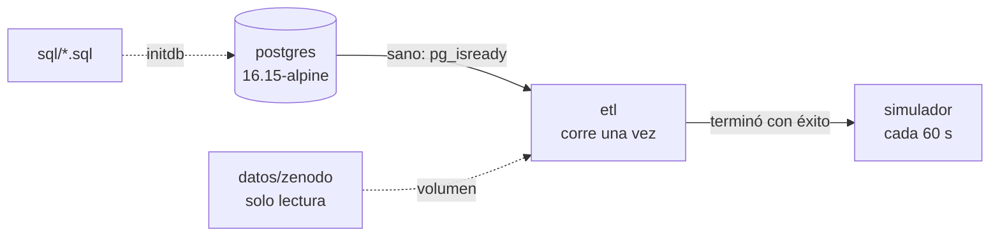

# Contenedores (§4 K.1)

## 1. Imágenes propias

| Imagen | Dockerfile | Contenido | Tamaño |
|---|---|---|---|
| `taller6/etl:1.0.0` | [`etl/Dockerfile`](../etl/Dockerfile) | Python 3.13 + pandas, numpy, psycopg + código del ETL | 393 MB |
| `taller6/simulador:1.0.0` | [`simulador/Dockerfile`](../simulador/Dockerfile) | Python 3.13 + psycopg + `simulador.py` | 194 MB |

**Imagen base: `python:3.13.18-slim-trixie`** (Debian 13 reducido, 178 MB).

| Alternativa | Por qué no |
|---|---|
| `python:3.13` (completa, ~1 GB) | Trae compiladores y bibliotecas que no usamos: más tamaño y más superficie de ataque |
| `python:3.13-alpine` (~50 MB) | Usa musl en lugar de glibc: pandas y numpy no siempre tienen ruedas listas y habría que compilar (imagen final más grande y construcción lenta) |
| Imagen distroless | Más pequeña, pero sin shell: difícil de depurar en un taller académico |

Lo que suma tamaño en el ETL: pandas + numpy (~200 MB). El simulador no los necesita, por eso pesa la mitad.
Las dos imágenes comparten la capa base: en el equipo y en el clúster se descarga una sola vez.

**Buenas prácticas aplicadas**

- Versión fija en la base y en cada dependencia (`requirements.txt`): nada de `latest`.
- Las dependencias se instalan **antes** de copiar el código: cambiar el código no reinstala paquetes.
- Usuario sin privilegios (`uid 10001`).
- `.dockerignore`: no entran cachés ni scripts de las fases 1 y 2.
- **Sin datos ni secretos en la imagen:** la fuente (4,4 GB) se monta como volumen de solo lectura y las
  credenciales llegan como variables de entorno.

## 2. Prueba local con Docker Compose

[`docker-compose.yml`](../docker-compose.yml) levanta la solución completa en el equipo:



| Requisito | Cómo se cumple |
|---|---|
| Encontrar PostgreSQL por nombre | `PGHOST=postgres` (nombre del servicio) |
| Credenciales fuera del código | `env_file: .env` (ignorado por Git; plantilla en `.env.example`) |
| Orden de arranque | `depends_on` con `service_healthy` y `service_completed_successfully` |
| El ETL corre una vez | `restart: "no"`; deja su resultado en `silver.etl_ejecucion` |
| Datos persistentes | Volumen `pgdata` |

```bash
cp .env.example .env                      # y poner una contraseña
docker build -t taller6/etl:1.0.0 etl
docker build -t taller6/simulador:1.0.0 simulador
docker compose up -d                      # espera a que el ETL termine (~6 min la primera vez)
docker compose logs etl                   # reglas de calidad y conciliación
docker compose down                       # apagar (los datos quedan en pgdata)
```

`docker compose up -d --build` también construye las imágenes; en el equipo de desarrollo falló el
constructor *bake* de Docker Desktop, por eso se documentan los `docker build` explícitos.

**Cuidado:** `docker compose start simulador` respeta las dependencias y **vuelve a correr el ETL**
(no hace daño porque es idempotente, pero tarda). Para reiniciar o cambiar de escenario solo el simulador:

```bash
ESCENARIO=red_caida docker compose up -d --no-deps simulador
```

**Rendimiento observado:** dentro del contenedor el ETL tarda más que en local porque lee la SQLite a
través del montaje de carpetas de Windows (por ejemplo, la huella SHA-256 pasa de 6 s a 38 s).
