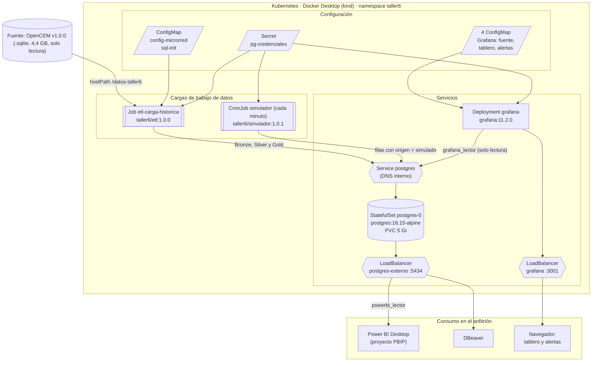
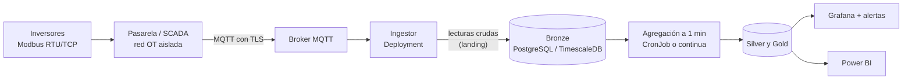

# Arquitectura y análisis (§4 I y K)

## 1. Arquitectura completa, de la fuente al consumo

**Capas de datos dentro de PostgreSQL** (arquitectura *medallion*):

| Capa | Esquema | Contenido | Quién la lee |
|---|---|---|---|
| Bronze | `bronze` | Copia 1:1 de `context` en `jsonb` (el resto queda en el `.sqlite`) | Solo el ETL |
| Silver | `silver` | Lecturas limpias a 1 minuto, contexto sin datos personales, eventos, auditoría del ETL | Solo el ETL |
| Gold | `gold` | Estrella: 8 dimensiones, 4 hechos, tarifa y vistas de indicadores | Grafana, Power BI, DBeaver |

## 2. Clúster local y llegada de las imágenes (K.2)

**Elección: Kubernetes de Docker Desktop (modo *kind*).**

| Alternativa | Por qué no |
|---|---|
| minikube | Habría que instalarlo y mantener otra máquina virtual; ya hay Docker Desktop |
| k3d / kind por separado | Equivalentes funcionales; Docker Desktop ya trae un clúster kind y se activa con un clic |
| **Docker Desktop (elegida)** | Cero instalación adicional, un solo nodo (lo que pide el nivel básico), integra `kubectl` y los `LoadBalancer` hacia `localhost` |

**Cómo llegan las imágenes propias.** En modo *kind* el nodo es un contenedor con su propio *containerd*: **no ve las
imágenes locales de Docker**. `k8s\levantar.ps1` las exporta con `docker save` y las importa en el nodo
(`ctr -n k8s.io images import`); los manifiestos usan `imagePullPolicy: IfNotPresent`. No se usa un registro externo.
La fuente de datos (4,4 GB) tampoco llega sola: el script la copia al nodo (`docker cp`) y el Job la monta como `hostPath`.

## 3. Objetos de Kubernetes elegidos y por qué (K.3)

| Necesidad | Objeto elegido | Alternativas descartadas y por qué |
|---|---|---|
| Aislar el proyecto | **Namespace** `taller6` | Etiquetas sueltas no aíslan nombres ni permiten borrar todo con un comando; con el namespace, `borrar.ps1` es una línea |
| Base de datos que no pierde datos | **StatefulSet** + `volumeClaimTemplates` (PVC 5 Gi) | *Deployment* + PVC: no da identidad estable (`postgres-0`) ni reanuda el mismo volumen de forma garantizada; *Pod* suelto: nadie lo recrea |
| Grafana siempre disponible | **Deployment** (1 réplica) | *StatefulSet*: Grafana no guarda estado propio (todo viene por provisioning), así que no necesita identidad ni volumen; *Pod* suelto: no se recupera |
| Tablero y fuente de datos al iniciar | **4 ConfigMap** montados en `/etc/grafana/provisioning` | Importar el tablero a mano desde la interfaz: no es reproducible ni se versiona |
| Credenciales fuera del código | **Secret** `pg-credenciales`, creado por `levantar.ps1` desde `.env` | ConfigMap: es texto plano sin protección; variables en el manifiesto: quedarían en Git |
| Configuración no sensible | **ConfigMap** `config-microrred` | Constantes en el código: obligaría a reconstruir la imagen para cambiar un umbral (la sustentación lo puede pedir) |
| Encontrar PostgreSQL por nombre | **Service** headless `postgres` (DNS `postgres`) | IP del pod: cambia en cada reinicio; ClusterIP normal: también sirve, pero el headless es lo que exige el StatefulSet |
| Carga histórica una vez | **Job** `etl-carga-historica` (`backoffLimit: 1`) | *Deployment*: reiniciaría el ETL para siempre; *CronJob*: repetiría la carga sin necesidad |
| Datos nuevos periódicos | **CronJob** `simulador` (`* * * * *`, `concurrencyPolicy: Forbid`) | *Deployment* con bucle: un pod gastando recursos entre ciclos y sin historial de ejecuciones |
| Saber si está sano | **readinessProbe** y **livenessProbe** (`pg_isready`, `/api/health`) | Sin sondas: Kubernetes no sabría si PostgreSQL acepta conexiones ni reiniciaría un Grafana colgado |
| No agotar el equipo | **requests / limits** de CPU y memoria en todos los contenedores | Sin límites: el ETL (pandas) podría consumir toda la memoria del anfitrión |
| Acceso desde el anfitrión | **Service tipo LoadBalancer** (`:5434` y `:3001`) | *NodePort*: en *kind* queda dentro del nodo y no llega a Windows (se probó); *port-forward*: hay que dejar una terminal abierta |
| Esperar a la base antes del ETL | **initContainer** con `pg_isready` | `sleep` fijo: frágil; reintentos dentro del ETL: mezcla preocupaciones |

**Por qué PostgreSQL no se escala como Grafana** (bonificación). Grafana no tiene estado propio: subir `replicas` a 2 o 3 detrás del
mismo Service funciona, porque cada réplica lee la misma configuración. PostgreSQL sí tiene estado: dos réplicas apuntando a un
mismo volumen corromperían los datos, y cada una con su volumen serían dos bases distintas. Escalarlo exige replicación
(primario + réplicas de lectura con streaming) y un operador que coordine la conmutación.

## 4. Power BI frente a Grafana: por qué no se intercambian

| | **Grafana** | **Power BI** |
|---|---|---|
| Pregunta que resuelve | **¿Está bien ahora y tengo que actuar?** Estado, tendencia de la última hora, alertas | **¿Qué pasó, por qué y qué conviene hacer?** Tendencias mensuales, comparaciones, escenarios |
| Usuario | Equipo de mantenimiento y operación (P5–P7) | Dirección de infraestructura, finanzas e investigadores (P1–P4, P8–P11) |
| Frecuencia | Casi en tiempo real: refresco de 1 min, alertas cada minuto | Mensual o semanal; el modelo se actualiza bajo demanda |
| Grano de datos | Minuto, últimas 3 h (`v_estado_actual`, `fact_energia_minuto`) | Día y mes; histórico completo, sin las filas simuladas |
| Consulta | SQL directo a la base en cada refresco, sin copia | Modelo importado en memoria con relaciones, tabla de fechas y medidas DAX |
| Alertas | Sí: reglas provisionadas (O1 batería baja, O2 red caída) | No; no es su función |
| Escenarios *what-if*, inteligencia de tiempo, *drill-down* de negocio | Limitado | Sí: parámetros de tarifa y generación solar, mes anterior, año acumulado |
| Configuración | Todo por archivos (*provisioning*), reproducible desde cero | Proyecto PBIP versionado en Git; se abre en el escritorio |
| Riesgo si se usara el otro | Un tablero de dirección en Grafana no tendría el modelo semántico ni los escenarios | Un tablero de operación en Power BI no avisaría de una red caída ni refrescaría cada minuto |

La frase para la sustentación: **Grafana responde "¿qué está pasando?" y avisa; Power BI responde "¿qué decisión tomo?".**

## 5. Evolución si los datos llegaran directamente de los inversores (Modbus) o de un SCADA

Hoy los datos entran por **lotes**: un archivo, un Job. Con una fuente en vivo cambia el cómo, no el qué (el modelo en estrella y los indicadores se conservan).

| Aspecto | Hoy (archivo) | Con Modbus / SCADA |
|---|---|---|
| Ingesta | Job que corre una vez | `Deployment` ingestor permanente (sondeo cada 10–15 s, cadencia real de los inversores) |
| Transporte | `hostPath` | MQTT con TLS o consulta a la API del SCADA; el cliente Modbus **solo lee** (registros de función 03/04, nunca escritura) |
| Almacenamiento | PostgreSQL | PostgreSQL con **TimescaleDB** (hipertablas y compresión) cuando el volumen crezca |
| Silver | Agregación por lote a 1 min | Agregación continua; `ON CONFLICT (inversor, minuto)` ya garantiza idempotencia ante reenvíos |
| Calidad | Reglas Q1–Q11 al cargar | Las mismas reglas en el ingestor; las alertas O4 (sin datos) pasan a vigilar la comunicación real |
| Simulador | Sustituto de la fuente en vivo | Se retira, o se deja para pruebas |
| Seguridad | Red local | Segmentación IT/OT, el ingestor es el único puente, credenciales Modbus en `Secret`, `NetworkPolicy` |
| Contrato de datos | Esquema de OpenCEM | Un esquema acordado con el fabricante (mapa de registros, unidades, escalas) para no repetir el trabajo de deducir unidades del diccionario |
| Lo que **no** cambia | | Modelo en estrella, vistas de indicadores, tableros y alertas |
